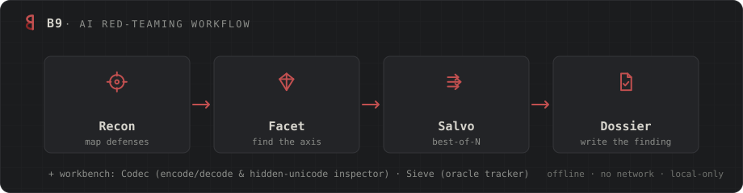

#  &nbsp;B9 — AI red-teaming Swiss knife

> Thirteen offline tools to **map, break, defend, and report** how an LLM fails — without a single request to the internet.




**B9** is a browser-based Swiss knife for **authorized** AI red-teaming (Gray Swan Arena, HTB labs, in-scope bounties). It runs entirely from `file://` — no backend, no build step, no dependencies — and **nothing ever leaves your machine**. You write the payloads; B9 makes the manual loop fast, reproducible, and reportable: it generates variations, tracks what lands, maps the model's defenses, and drafts the disclosure. Submission stays manual, by design.

> The one exception to "zero network" is **Arbor's optional localhost adapter**: when you explicitly switch it on, it talks to a model server on `127.0.0.1` (e.g. Ollama) to automate the target + judge loop. It still never touches the internet — the data stays on your machine — and it is **off by default**. Every other tool makes no network call of any kind.

In one line: **the bookkeeping-and-methodology layer around manual red-teaming.** The attack text is yours — B9 gives it reach, memory, and a paper trail.

---

## The tools

| Step | Tool | Scheme | What it does |
|:---:|------|--------|--------------|
| ① | **Recon** | `RECON://scope` | Fingerprint the target's defense stack — identity, system prompt, guardrail topology, capabilities, obfuscation channels, and **agentic / indirect (XPIA) surfaces** (untrusted-data entry · auto-exec · exfil egress · canary) — and get a **live decision-tree opening move**. The recon worksheet, turned into a plan. |
| ② | **Facet** | `FACET://lab` | Re-express your own benign payload along four neutral linguistic axes (verb/term · register · mood · abstraction) to **map which wording a model reacts to**. Transform-only; a neutral lexicon is the safety boundary. |
| ③ | **Salvo** | `SALVO://variant-lab` | **Best-of-N.** Fire many small, *seeded* perturbations of a base payload (13 strategies — incl. prefix-opener & refusal-suppression) and track the per-variant hit rate to catch the low-probability success. |
| ⇡ | **Climb** | `CLIMB://crescendo` | **Multi-turn — the strongest lever.** Plan a Crescendo escalation turn by turn (benign entry → anchor to the model's own words → the goal as a continuation), track what poisoned the context, and backtrack or branch. Includes a **many-shot priming** panel (stack your own benign demos, budget the context) that composes with the climb. |
| ⑂ | **Arbor** | `ARBOR://tree` | **Tree of attacks (TAP).** Branch a base goal, judge each reply 0–100, and **prune** the losers under a width/depth budget — the search picks the next move. Human-in-the-loop by default; an **optional localhost adapter** (127.0.0.1 only, off by default) auto-runs the target + judge against a model on your own machine. |
| ④ | **Dossier** | `DOSSIER://report` | Turn logged attempts into a **submission-ready disclosure** classified across the **full OWASP LLM Top-10 (2025) + MITRE ATLAS** with a per-class disclosure note: steps, impact, negative results, and the valid-finding gates checklist. Imports a Salvo/Facet export as evidence. |
| ◇ | **Codec** | `CODEC://bench` | Reversible encode/decode bench (Base64, hex, binary, URL, ROT13, Caesar, Atbash, reverse, Morse, NATO, leet) with a round-trip self-test. Encode the ask, decode the reply. |
| ◇ | **Lens** | `LENS://defense` | **Defensive bench.** Inspect untrusted text for **hidden Unicode** (zero-width / bidi / Tags-block / homoglyph), scan a model's output for **XSS & exfil sinks**, detect **planted injections** (XPIA), and apply **spotlighting** (delimit / datamark / encode) — the blue-team half of the kit. |
| ◇ | **Sieve** | `SIEVE://oracle` | Client-side **oracle tracker** for authorized extraction of a benign lab secret: log closed-ended answers (boolean / range / code-point), reconstruct the value in a position table, and **stop the moment it validates**. |
| ◇ | **Ledger** | `LEDGER://campaign` | **Cross-tool campaign dashboard.** Import Salvo/Facet exports and aggregate ASR by **MLCommons family** and class across targets — with a 95% lower bound, a best-of-N estimate, and a "3 refusals → rotate the class" signal. |
| ◇ | **Verdict** | `VERDICT://score` | **Honest response scorer.** Grade a model reply against the scenario's *exact* success condition — refusal vs **jailbreak-tax** (complied but useless) vs real success — and get the result to log. "Didn't refuse" is not a win (StrongREJECT). |
| ◇ | **Atlas** | `ATLAS://method` | **Methodology reference.** A searchable deck of the taxonomies (MLCommons families · OWASP LLM/Agentic · MITRE ATLAS), techniques, defenses, and doctrine behind the kit — each entry cross-linked to the tool that applies it. A map, not a payload library. |
| ◇ | **Raster** | `RASTER://vision` | **Multimodal bench.** Render your own benign text into an **image carrier** (FigStep list / typographic / low-contrast) for a vision target, and **inspect** an uploaded image for hidden-text injection — PNG `tEXt/zTXt/iTXt` chunks, JPEG comments, data appended after the end marker, embedded strings. Canvas + byte parsing, no OCR. |

**The loop:** `Recon` maps the defenses → `Facet` finds the framing that works → `Salvo` perturbs it Best-of-N to raise the hit rate → `Dossier` writes it up. `Climb` and `Arbor` run the deeper search (multi-turn, and TAP tree-search). `Codec`, `Lens`, `Sieve`, and `Raster` are the workbench you reach for mid-hunt — `Lens` and `Raster` are also where you verify your own defenses hold, and `Atlas` is the methodology map underneath it all.

---

## Why it's built this way

- **Offline by construction.** No `fetch`, `WebSocket`, CDN, web font, or analytics — anywhere. Open `index.html` with the network cable unplugged and everything works. CI fails the build on any external host reference. The single, isolated exception is Arbor's opt-in localhost adapter (`127.0.0.1` only); CI asserts the one `XMLHttpRequest` lives there and nowhere else, and that nothing points at the internet.
- **Zero dependencies, zero build.** Plain HTML + vanilla JS + one CSS file. Edit a file, reload. Nothing to install.
- **Deterministic.** Generation is seeded: the same `(base + options + seed)` always produces the identical batch, and variant #1 is always the untouched control.
- **One system.** Every tool shares the **Carbon** theme; the trackers share one engine (`core.js`), the workbench tools share one helper lib (`kit.js`). Flip between tools and it's the same keyboard loop, the same stats, the same exports.
- **Private by construction.** All state is `localStorage` only (try/catch-wrapped, private-window safe). Export from the top bar as **Markdown**, **CSV** (per-variant for the trackers, aggregate tables for Ledger), or **JSON**.

---

## Quick start

```bash
git clone https://github.com/k074m4n/B9.git
cd B9
# open the hub in a browser — no server needed:
xdg-open index.html     # Linux   (or: open index.html on macOS)
```

Pick a tool, write a base payload, hit **Generate**, then run the keyboard loop (trackers):

| key | action | | key | action |
|:---:|--------|---|:---:|--------|
| `c` | copy current variant | | `j` / `k` | next / previous |
| `1`–`4`, `0` | log result | | `u` | undo last log |
| | | | `?` | shortcuts help |

Copy → paste into the Arena chat yourself → log the result → repeat. Pane C updates live with the success rate, the per-strategy / per-family (MLCommons) breakdown, and a best-of-N estimate.

Every tool carries an **ⓘ button** in its top bar with a built-in, tool-specific "how to use" — steps, tips, and the doctrine behind it — so you never need to leave the page.

---

## Testing

A dependency-free Node suite drives the real tools through a hand-rolled DOM — mount, generate, log, undo, persist, reload, export, import, keyboard loop, theme sync, and every workbench tool's pure logic:

```bash
npm test     # → 80 checks, 0 deps
```

---

## Project layout

```
B9/
├─ index.html              # platform hub / launcher
├─ shared/
│  ├─ theme.css            # "Carbon" design system — single source of truth
│  ├─ core.js              # tracker engine: 3-pane shell · variant queue · stats ·
│  │                       #   export/import · seeded PRNG · word diff · keyboard loop
│  ├─ kit.js               # lightweight plumbing for the workbench tools
│  ├─ icons.js             # inline SVG glyphs + the interlocking B9 logo
│  └─ logo.svg             # standalone brand mark
├─ tools/
│  ├─ salvo/   facet/      # attack    (core.js) — Best-of-N · reframing
│  ├─ climb/   arbor/      # attack    (kit.js)  — multi-turn Crescendo · TAP tree-search
│  ├─ recon/   dossier/    # workbench (kit.js)  — target worksheet · report builder
│  ├─ codec/   lens/       # workbench (kit.js)  — reversible codecs · defensive bench
│  ├─ sieve/   atlas/      # workbench (kit.js)  — oracle tracker · methodology reference
│  ├─ ledger/  verdict/    # workbench (kit.js)  — campaign ASR · response scorer
│  └─ raster/              # workbench (kit.js)  — multimodal carrier + image inspector
├─ test/                   # minidom.js + run.js — the 80-check suite
└─ .github/workflows/      # CI: npm test + the no-network assertion
```

Each tool is a thin page: the trackers hand a small spec to `B9.mountTool()` and the engine builds the identical shell; the workbench tools wire their own UI over `kit.js`. The shared result vocabulary (`success / partial / refused / flagged / fail`) and taxonomy rollups mean reports from different tools line up.

---

## Scope & safety

> B9 is for **authorized testing only** — sanctioned engagements, CTF/lab targets, your own systems.

- It **never contacts any website**, never auto-submits, and never tries to de-anonymize a model (Arena Rules 3 & 4). The tool's job ends at *"here is text to copy."*
- Findings are framed for **responsible disclosure** (OWASP LLM07 / MITRE ATLAS), negative results included.

---

<sub>Built as a portfolio project. Design system: **Carbon** (ink & paper, matte). Status: active — more tools and polish landing on `main`.</sub>
